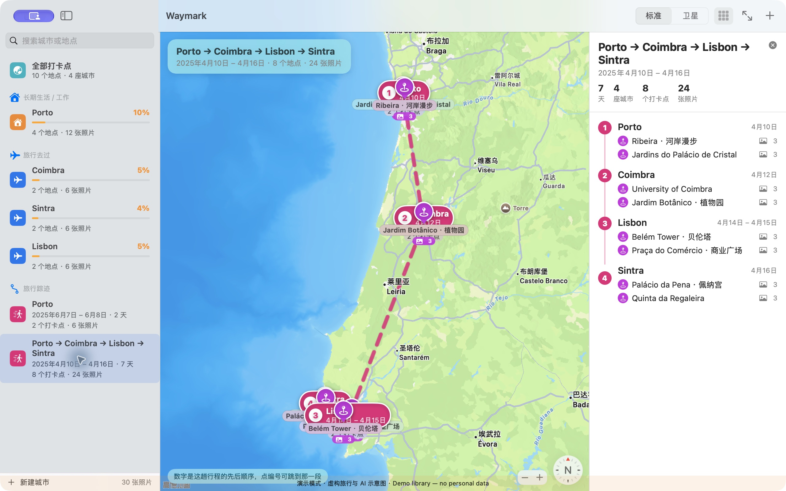
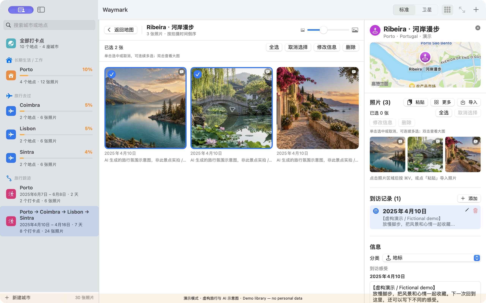
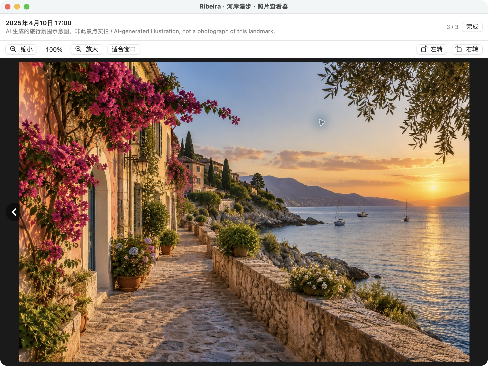

# Waymark

**A quiet, map-first home for the places you have been and the memories you brought back.**

[简体中文](README.zh-CN.md) · [Download](../../releases) · [Privacy](docs/PRIVACY.md) · [Contributing](CONTRIBUTING.md)

> The app interface is currently in Chinese. These project documents are available in English and Chinese.


*Promotional AI-generated illustration, not evidence of an actual trip. [Media provenance](docs/media/README.md).*

Waymark is a native macOS travel journal built around Apple Maps. Pin a place, record each visit, attach the photos and thoughts that belong to it, and let your travel history take shape across cities and time.

There is no Waymark account and no Waymark cloud service. Your journal and imported photo copies live on your Mac. Apple Maps, place search, and geocoding use Apple's online services, so the map experience is not fully offline.

## Why Waymark

- **Your memories, spatially organized.** See every check-in on one map, then focus on a city, place, or journey without losing context.
- **Visits stay distinct.** Return to the same place years later and keep a separate date and reflection for each visit.
- **Journeys emerge from dates.** Check-ins no more than three days apart are grouped into trips automatically. The dashed lines are straight chronological connections, not roads or navigation routes.
- **A photo workflow made for Mac.** Drag in images or a whole folder, paste from Finder or the clipboard, review detected dates, and correct one photo or an entire batch before importing.
- **A useful sense of exploration.** A city view highlights nearby one-kilometre grid cells and gives you an approximate, personal exploration score—not an official area measurement.
- **Local, legible storage.** Place and visit metadata is stored as JSON; imported originals are copied into the app's Application Support folder.



*Actual Waymark interface using public landmark coordinates with fictional demo dates, routes, and notes.*

## Photo memories, without giving up the originals

Waymark keeps a local copy of each imported original. Gallery previews are generated on demand and cached in memory rather than saved as another permanent image set.

- Single-click photos to select or deselect them; double-click to open the large viewer.
- Multi-select without holding Command, then batch-edit capture date or caption.
- During import, apply one date to the whole batch and still fine-tune individual items.
- Zoom, pan, step through an album, or rotate in 90° increments.
- Date, caption, and rotation changes update Waymark's metadata; they do not rewrite the original file or its EXIF data.





*Screenshots use the isolated fictional demo library. The scenic images shown are AI-generated illustrations, not photographs of the named landmarks. [Media provenance](docs/media/README.md).*

## Requirements

- macOS 14 Sonoma or later
- Apple Silicon for the downloadable release (`arm64`)
- An internet connection for Apple map tiles, place search, and geocoding

The prebuilt release does not run on Intel Macs. Intel users may build the Swift source locally, but Intel is currently untested and not an officially supported release target.

## Download and open

1. Download the latest DMG and `SHA256SUMS` from the same [Release](../../releases).
2. Before opening it, confirm that you trust the release source and verify the download in Terminal from the folder containing both files:

   ```bash
   shasum -a 256 -c SHA256SUMS
   ```

   Continue only if the DMG reports `OK`.
3. Open the DMG, drag **Waymark.app** to **Applications**, and try to open it normally.
4. If macOS says the developer cannot be verified or Apple cannot check the app, proceed only if you trust the source and the checksum matched. After that first attempted open, go to **System Settings → Privacy & Security**, scroll to **Security**, and use **Open Anyway** if macOS offers it; review the warning before confirming **Open**. See Apple's [official guidance for safely opening Mac apps](https://support.apple.com/en-us/102445).

The DMG is unsigned and not Apple-notarized. The app inside is ad-hoc signed so macOS can launch the bundle, but it is not Developer ID signed. Do not disable Gatekeeper globally, and do not override a warning that says the app contains malware or is damaged—download it again from the trusted release or build from reviewed source instead.

## Try the demo library

A normal first launch opens an empty library: Waymark never ships personal travel data into your journal.

To explore the interface, choose **打开演示资料库 / Open Demo Library** from the menu bar, or run:

```bash
./package.sh --demo
```

Demo mode uses a separate `Waymark-Demo` data folder. It contains 10 public landmarks in Portugal, while all 2025 dates, routes, and notes are fictional. Its three scenic images are AI-generated illustrations and are explicitly not photographs of the landmarks. Demo mode neither reads nor modifies the normal Waymark library.

## Build from source

Install Apple's Command Line Tools if needed:

```bash
xcode-select --install
```

Then clone and package the app:

```bash
git clone https://github.com/Weichengphy/Waymark-Mac.git Waymark
cd Waymark
./package.sh
open dist/Waymark.app
```

Packaging commands:

| Command | Result |
| --- | --- |
| `./package.sh` or `./package.sh --build` | Release-builds and assembles `dist/Waymark.app` |
| `./package.sh --run` | Builds and launches the normal library |
| `./package.sh --demo` | Builds and launches a new instance with the isolated demo library |
| `./package.sh --dmg` | Builds `dist/Waymark-<version>-macOS-<arch>.dmg` and `dist/SHA256SUMS` |
| `./script/build_and_run.sh` | Release-builds through `package.sh` and launches the normal library |

The development wrapper also accepts `--demo`, `--debug`, `--verify`, `--logs`, and `--telemetry`; run it without arguments for its normal release-build-and-launch path.

The project is a Swift Package using SwiftUI and MapKit; it has no third-party package dependencies.

Run the test suite with:

```bash
swift test
```

Release verification: all 34 tests passed.

## A short tour

1. **Add a check-in.** Click the map and choose **在这里打卡**, Option-click for the shortcut, or search by place name in the new-place sheet.
2. **Record the return visits.** Each visit has its own date and reflection; Waymark shows the newest by default.
3. **Bring in photos.** Drop files or a folder onto the place inspector, paste with `⌘V`, or use the import button. Review the date and caption before committing.
4. **Browse by city or trip.** Search the sidebar, open a city's overview, or choose an automatically derived journey to see its numbered stops.
5. **Manage carefully.** Deleting a place, city, or imported photo also deletes the corresponding copies inside Waymark after confirmation. It never deletes source files outside Waymark's data folder.

Waymark does not provide real-time GPS tracking, turn-by-turn navigation, iCloud sync, or automatic device-to-device sync. Trip lines describe the order of your dated visits; they do not claim the path you actually travelled.

## Data and privacy

The normal library is stored under:

```text
~/Library/Application Support/Waymark/
├── data.json
├── cities.json
└── Photos/
```

The demo library uses the sibling `Waymark-Demo` folder. For details about network access, clipboard behavior, photo metadata, deletion, and backups, read the [privacy guide](docs/PRIVACY.md).

## Contributing

Bug reports, focused improvements, and thoughtful accessibility or localization work are welcome. Please read [CONTRIBUTING.md](CONTRIBUTING.md) before opening a pull request.

## License

Waymark is released under the [MIT License](LICENSE). Copyright © 2026 Wei Cheng.
