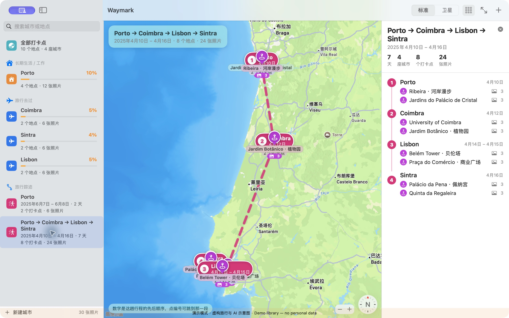
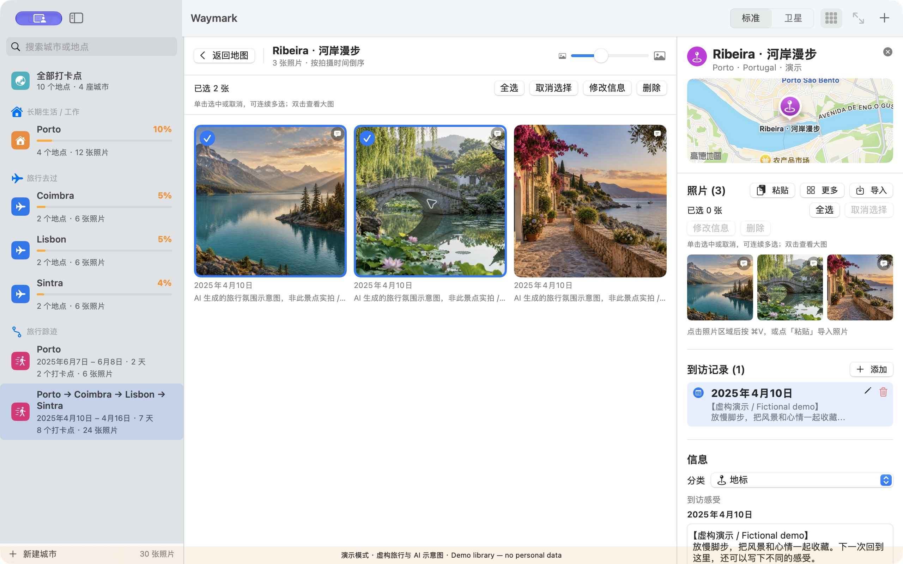
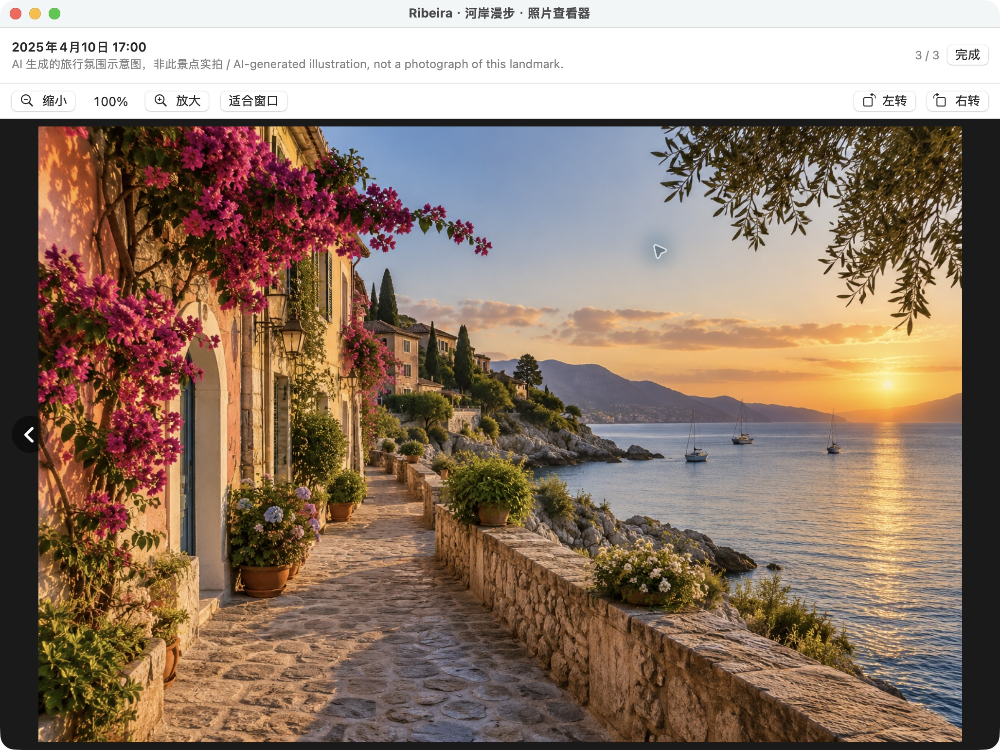

# Waymark

**把去过的地方、当时的心情和带回来的照片，安静地留在一张地图上。**

[English](README.md) · [下载](../../releases) · [隐私说明](docs/PRIVACY.md) · [参与贡献](CONTRIBUTING.md)

> Waymark 当前使用中文界面；项目文档提供中英文版本。


*AI 生成的宣传示意图，不代表真实旅行经历。[查看素材来源](docs/media/README.md)。*

Waymark 是一款围绕 Apple 地图设计的原生 macOS 旅行记录应用。你可以标记地点、分别记录每次到访、归档照片与感受，再让一段段旅程从时间和城市之间自然浮现。

Waymark 没有账号，也没有自己的云端服务。旅行记录和导入的照片副本保存在你的 Mac 上。Apple 地图、地点搜索与地理编码会使用 Apple 的在线服务，因此地图体验并非完全离线。

## 为什么做 Waymark

- **让回忆回到发生的位置。** 在一张地图上看遍所有打卡，也可以聚焦到一座城市、一个地点或一段旅程。
- **每次到访都值得单独留下。** 多年后重回同一个地方，可以保存新的日期和新的感受，而不是覆盖旧记录。
- **旅程从日期自动生成。** 间隔不超过 3 天的到访会归为同一趟旅行。地图上的虚线只是按时间连接各站的直线，不代表道路、导航或真实行进轨迹。
- **为 Mac 设计的照片流程。** 拖入照片或整个文件夹，从访达或剪贴板粘贴，检查识别到的时间，再逐张或批量修正后导入。
- **直观但克制的探索度。** 城市视图会点亮打卡点附近的一公里网格，并给出个人化的近似探索度；它不是行政区面积的精确统计。
- **本地、可读的数据。** 地点与到访信息保存为 JSON，导入的原图会复制到应用的 Application Support 文件夹。



*真实 Waymark 界面；使用公共地标坐标，日期、路线与文字记录均为虚构演示内容。*

## 照片记忆，原图不被改写

Waymark 为每张导入照片保存一份本地原图副本。画廊预览按需生成并缓存在内存中，不额外落盘保存一套永久缩略图。

- 单击照片选中或取消，双击打开独立大图查看器。
- 无需按住 Command 即可连续多选，再批量修改拍摄时间或说明。
- 导入时可把同一日期应用到整批照片，也可继续逐张微调。
- 支持缩放、拖动、前后切换，以及每次 90° 的左右旋转。
- 日期、说明和旋转只更新 Waymark 的记录，不会重写原图文件或 EXIF。





*截图来自独立的虚构演示资料库；画面中的风景图是 AI 生成的示意插画，并非所标景点的实拍照片。[查看素材来源](docs/media/README.md)。*

## 系统要求

- macOS 14 Sonoma 或更高版本
- 下载版仅支持 Apple 芯片（`arm64`）
- Apple 地图瓦片、地点搜索与地理编码需要网络连接

预编译版本无法在 Intel Mac 上运行。Intel 用户可以尝试从 Swift 源码自行构建，但目前没有经过 Intel 测试，也不属于正式支持的发布目标。

## 下载与首次打开

1. 从同一个 [Release](../../releases) 下载最新 DMG 和 `SHA256SUMS`。
2. 打开文件前，先确认你信任发布来源，并在终端进入两个文件所在的目录后校验下载内容：

   ```bash
   shasum -a 256 -c SHA256SUMS
   ```

   只有 DMG 显示 `OK` 时才继续。
3. 打开 DMG，把 **Waymark.app** 拖入「应用程序」，然后先尝试正常打开。
4. 如果 macOS 提示无法验证开发者或 Apple 无法检查 App，请只在信任来源且校验值一致时继续。在第一次尝试打开之后，进入「**系统设置 → 隐私与安全性**」，滚动到「安全性」；如果系统提供「**仍要打开**」，请再次检查警告内容后确认「打开」。参见 Apple 的[安全打开 Mac App 官方说明](https://support.apple.com/en-us/102445)。

DMG 本身没有签名，也没有经过 Apple 公证。其中的 App 使用 ad-hoc 签名，以便 macOS 正常启动应用包，但没有 Developer ID 签名。请不要在系统范围内关闭 Gatekeeper，也不要绕过“包含恶意软件”或“App 已损坏”一类警告；请从可信 Release 重新下载，或审阅源码后自行构建。

## 体验演示资料库

普通模式第一次启动时是空白资料库：Waymark 不会把任何个人旅行记录放进公开版本。

想先看看完整界面，可以从菜单栏选择 **打开演示资料库 / Open Demo Library**，也可以运行：

```bash
./package.sh --demo
```

演示模式使用独立的 `Waymark-Demo` 数据文件夹。其中包含葡萄牙的 10 个公共地标，但所有 2025 年日期、路线和文字记录均为虚构；三张风景图均为 AI 生成的示意插画，并非对应景点的实拍照片。演示模式不会读取或修改普通 Waymark 资料库。

## 从源码构建

如尚未安装 Apple Command Line Tools：

```bash
xcode-select --install
```

然后克隆并打包：

```bash
git clone https://github.com/Weichengphy/Waymark-Mac.git Waymark
cd Waymark
./package.sh
open dist/Waymark.app
```

打包命令：

| 命令 | 结果 |
| --- | --- |
| `./package.sh` 或 `./package.sh --build` | 以 Release 模式构建并生成 `dist/Waymark.app` |
| `./package.sh --run` | 构建并启动普通资料库 |
| `./package.sh --demo` | 构建并以新实例启动独立演示资料库 |
| `./package.sh --dmg` | 生成 `dist/Waymark-<版本>-macOS-<架构>.dmg` 与 `dist/SHA256SUMS` |
| `./script/build_and_run.sh` | 通过 `package.sh` 进行 Release 构建并启动普通资料库 |

开发包装脚本还接受 `--demo`、`--debug`、`--verify`、`--logs` 和 `--telemetry`；不带参数时执行普通的 Release 构建并启动。

项目使用 Swift Package、SwiftUI 与 MapKit，没有第三方包依赖。

运行测试：

```bash
swift test
```

本次发布验证：34 个测试全部通过。

## 五分钟上手

1. **创建打卡。** 单击地图后选择「在这里打卡」，也可以按住 Option 点击地图，或在新建界面中搜索地点名称。
2. **记录再次到访。** 每次到访都有独立的日期和感受，默认展示最近一次。
3. **导入照片。** 把照片或文件夹拖到地点检查器，按 `⌘V` 粘贴，或点击导入按钮；确认日期和说明后才会写入资料库。
4. **按城市或旅程浏览。** 在侧栏搜索、打开城市总览，或选择自动生成的旅程查看带编号的各站。
5. **谨慎整理。** 删除地点、城市或照片时，确认后也会删除 Waymark 数据目录中的对应副本；Waymark 不会删除其数据目录之外的源文件。

Waymark 不提供实时 GPS 轨迹、逐向导航、iCloud 同步或自动跨设备同步。旅程线只描述各次到访的时间顺序，并不声称还原实际走过的路线。

## 数据与隐私

普通资料库存放在：

```text
~/Library/Application Support/Waymark/
├── data.json
├── cities.json
└── Photos/
```

演示资料库使用同级的 `Waymark-Demo` 文件夹。有关网络访问、剪贴板、照片元数据、删除和备份的具体说明，请阅读[隐私说明](docs/PRIVACY.md)。

## 参与贡献

欢迎提交错误报告、小而清晰的改进，以及经过认真考虑的无障碍或本地化工作。发起 Pull Request 前，请先阅读 [CONTRIBUTING.md](CONTRIBUTING.md)。

## 许可证

Waymark 采用 [MIT License](LICENSE) 发布。Copyright © 2026 Wei Cheng。
